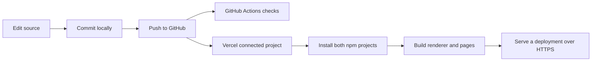

# Understand and own this portfolio

This guide describes the current implementation, including the empty-desk checkpoint. Its purpose is to help you explain the system, change it deliberately, and diagnose failures yourself.

The room renderer was adapted from Henry Heffernan's MIT-licensed source. We retained his rendering/camera foundation, added your entrance and local content app, and replaced the furnished scene with a bare desk. Keep that attribution when describing the project's origins. Being able to explain an adapted system means understanding its inherited parts as well as your changes.

## 1. A website is files plus instructions

A browser downloads files and interprets them:

| Piece             | Job                         | Example here                       |
| ----------------- | --------------------------- | ---------------------------------- |
| HTML              | Content and structure       | Your name, links, Start button     |
| CSS               | Appearance and layout       | Rounded card, recessed door panels |
| JavaScript        | Behavior                    | Start changes state; camera moves  |
| Images and models | Data those instructions use | Baked floor texture and desk GLB   |

TypeScript adds checks to JavaScript while we develop. Build tools convert it into JavaScript the browser can execute. It does not automatically make animation faster.

React organizes interface code into components: reusable functions describing UI. A component can have **state**, information that changes over time. The entrance's state includes asset progress and whether the door is closed, opening, or finished. React updates the interface when that state changes.

Next.js organizes React into routes and prepares the application for hosting. For example, `app/page.tsx` creates `/`, and `app/desktop/page.tsx` creates `/desktop`. Node.js runs our JavaScript development/build tools outside a browser. npm installs dependencies and runs commands defined in `package.json`. A dependency is another package our code uses; the lockfiles record the resolved dependency tree.

## 2. What happens when someone opens your link

```mermaid
sequenceDiagram
    participant V as Visitor's browser
    participant D as DNS
    participant H as Vercel hosting
    V->>D: Where does this hostname point?
    D-->>V: Hosting address
    V->>H: HTTPS request for /
    H-->>V: HTML and references to CSS/JavaScript
    V->>H: Request scripts, styles, textures, models
    H-->>V: Those files
    Note over V: JavaScript runs; the GPU draws the room
    Note over V: Start opens the door and moves the camera
```

DNS maps a hostname to hosting infrastructure. HTTPS encrypts traffic and verifies the server's identity using a certificate. The URL's path, such as `/projects/robotics`, identifies content within the site.

An iframe is a page embedded inside another page. Your home route embeds `/experience/index.html` in a full-screen iframe. The garage door and Three.js room run inside that embedded page. It is hosted on the same website.

The 3D frames are generated on the visitor's device. Vercel sends the model and code; it does not stream a rendered video of the room. This is why model size and graphics settings affect the visitor's experience.

## 3. Where everything is stored

| Place                | What it contains                                                                   |
| -------------------- | ---------------------------------------------------------------------------------- |
| GitHub repository    | Source code, committed model/texture exports, dependency lockfiles, history        |
| This cloud workspace | A checkout we edit, installed packages, generated files, running preview processes |
| Vercel deployment    | A built version of a particular Git commit, served to visitors                     |
| Visitor's device     | Downloaded/cached files and temporary CPU/GPU data                                 |
| Onshape              | Your editable CAD documents, assemblies and design history                         |

A Git **commit** is a recorded snapshot in local history. **Push** sends commits to GitHub. A **branch** names a line of development; `main` currently contains the active site. A deployment is a published build of a snapshot.

A running cloud preview depends on a process staying alive. GitHub is the durable shared record of pushed work. The old prototype archive in this workspace is only a local backup unless copied somewhere durable.

There is currently no application database, account system, or custom API powering this portfolio. Project content is in source files. Models and textures under public asset paths can be downloaded by visitors. Keep your editable CAD document separate and publish a prepared display copy.

A custom domain is an address you register and point to Vercel using DNS. It does not store the website. You can use the Vercel address before buying one.

## 4. Build, render, and deploy mean different operations

**Build:** turn developer-friendly source into files suitable for serving. It bundles modules, converts TypeScript/JSX, prepares CSS/assets, and creates page output. A build error means that preparation failed.

Your actual build has two steps:

```text
npm run build
  → npm run build:experience
      → Webpack bundles experience/src
      → copies experience/static into public/experience
  → next build
      → prepares the Next.js routes and client code
```

`public/experience` is generated and ignored by Git. We commit the inputs; the build recreates that folder. `.next` is also generated. `npm ci` installs exactly the locked dependency tree; it does not publish the site.

**Render:** draw the result. React/browser rendering produces the normal UI. Three.js rendering produces pixels in a canvas. Blender can also render offline while authoring an asset.

**Deploy:** make a build available on hosting.



`vercel.json` tells Vercel to install both dependency sets and run `npm run build`. The separate GitHub Actions workflow checks formatting/builds; it has no deployment step. Automatic publishing depends on the Vercel project's Git integration and branch settings.

A deployment-specific Vercel URL identifies one build and stays on that version. A production/branch alias can move to a newer deployment. A Vercel dashboard link opens management tools, not the portfolio itself. Check the deployment's commit and Ready status when deciding which version you are viewing. A local passing build establishes local build success, not hosted readiness.

## 5. How your current entrance works

Read `experience/src/Application/UI/components/LoadingScreen.tsx` alongside `experience/src/Application/UI/style.css`.

1. Asset-loading events update the loader's progress. A small CSS ring rotates beside a short status message. The displayed percentage is completed asset count divided by listed asset count, not downloaded bytes. Progress chooses the copy; there is no artificial wait to display all messages. Model, texture and audio failures are stored and reported, so a failed asset does not leave an endless spinner.
2. When assets are ready, the loader disappears and bold text sits directly on the closed door: “Hey! I’m Shreethan Palla. I build robots, RC cars, and software.” There is no card or Enter button. Open without 3D is a permanent entry alternative.
3. Downward scroll or upward touch movement accumulates into a target value between zero and one. A smoothing loop brings displayed progress toward that target. In the first 30%, the text moves upward and fades while the door stays closed. In the remaining 70%, the panels follow the curved overhead track. Scrolling back restores previous states until entry finishes.
4. Each door section's endpoints determine its center and tilt; CSS `translate3d` and `rotateX` show the movement. The door is a screen-space illusion rather than physical geometry in the room. Keyboard arrows/PageDown advance the same sequence; End or keyboard Enter can continue directly. Reduced-motion enters immediately.
5. Once the door has opened, its overlay is removed, scene interactions unlock, and `loadingScreenDone` starts the room camera approach. Until then, clicks cannot move the camera underneath the entrance.

The browser's `requestAnimationFrame` schedules updates before display frames. Scroll distance chooses a desired position; smoothing helps it settle toward that position. Stopping partway leaves the sequence partway through, rather than starting a compulsory timed movie. The static loader, direct content link and keyboard controls keep the portfolio usable without a pointer or motion effects.

## 6. How the 3D room works

Three.js manages a 3D scene and asks WebGL to draw it using the GPU.

- **Scene:** the container of objects.
- **Geometry:** vertices and triangles defining shape.
- **Mesh:** geometry plus its surface material.
- **Material:** how a surface appears; for example, color, roughness, metalness, or an image map.
- **Texture:** an image used by a material. UV coordinates tell each surface which image region belongs to it.
- **Camera:** the viewpoint and perspective.
- **Transform:** position, rotation and scale. A group lets several meshes share a transform.
- **Renderer:** turns the scene and camera into canvas pixels.

`Application.ts` creates the scene, resources, camera, renderer and world. `sources.ts` lists asset URLs. `World.ts` waits for those assets and adds the active environment. At this checkpoint it adds the background, tabletop, four legs and an interactive résumé sheet. The old computer, decor, chair and monitor are not displayed.

The room uses **baked lighting**: Blender calculates much of the appearance offline and stores it in a texture. `BakedModel.ts` applies that image with a basic material; the browser largely displays the already-shaded surface. This is different from recalculating every shadow with live lights every frame.

We rebuilt the bare desk and its floor shadows using `experience/tools/build-empty-workbench.py`. Its generated GLB and atlas are committed assets. The original backdrop is reused outside the cleared shadow region. The runtime tabletop tint matches the original darker desk. Blender is not needed to install or deploy the existing assets.

A baked shadow does not automatically update when an object moves. Future moving robot parts should retain their own materials and use suitable lighting/shadows. Do not send colored project CAD through `BakedModel`, because that helper replaces its materials with the room's shared texture.

The camera is driven by positions and points it looks at, defined in `CameraKeyframes.ts`. The current overview and desk close-up derive their target from the bounding box of the tabletop and legs, excluding the huge backdrop. The center is the midpoint of the minimum and maximum coordinates. Camera distance is calculated from the box corners, field of view, and viewport aspect ratio to leave consistent margins. Close-up no longer follows cursor coordinates. Tweens interpolate between views over time. The room currently uses unusually large coordinates: its model geometry is scaled by 900. New imports need explicit scale and placement; raw meter-scale CAD can otherwise seem invisible.

## 7. Where the computer interface fits later

The retained reference implementation can place `/desktop` inside a 3D monitor using CSS3DRenderer. Its buttons/text remain HTML. Pointer events are forwarded from that iframe so the room can react and move the camera.

That monitor is currently disabled along with the other desk objects. `/desktop` still works directly through Open without 3D. Adding the monitor back requires restoring the physical model and screen integration together. A monitor mesh alone will not produce a usable screen.

The app uses two isolated dependency sets: the inherited room has its compatible React/Three.js versions; `app/` uses modern Next/React and React Three Fiber for the project viewer. React Three Fiber expresses Three.js scenes as React components, and Drei supplies helpers. They do not replace the underlying 3D concepts. We keep the old room isolated to avoid breaking its rendering APIs during visual customization.

## 8. How scrolling makes a model explode

The current example on `/projects/robotics` is an illustrative rover made from simple geometry. It is not your FRC CAD and is not currently an object on the desk.

`app/projects/[slug]/viewer.tsx` measures how far its tall section has scrolled and normalizes that to a number `p` between zero and one. `app/components/assembly-scene.tsx` uses that value to separate groups.

The general calculation is:

```js
part.position =
  assembledPosition + separationDirection * separationDistance * p;
```

That is explanatory notation, not directly executable JavaScript vector arithmetic. A real Three.js version could be:

```js
part.position.copy(assembledPosition).addScaledVector(separationOffset, p);
```

At `p = 0`, a part is assembled. At `p = 0.5`, it is halfway along its offset. At `p = 1`, it is fully separated. Scrolling backward reverses the same calculation. The sample also eases progress for smoother motion. Reset from the saved assembled position every update; repeatedly adding offsets would make the part drift away.

CAD mates and engineering constraints do not automatically become browser animation. We choose named assemblies, separation directions, spacing, and explanatory labels. Components in differently rotated parent groups need offsets in the appropriate coordinate space.

Hover usually uses **raycasting**: project a ray from the cursor through the camera, find the intersected mesh, and identify its logical project. Then highlight it or show a label. Click/tap can open a case study or start a camera transition. A CAD export supplies geometry; this behavior is written in site code.

## 9. What to make and export from Onshape

Start with one small, recognizable project. A cube-solver assembly or an RC subsystem is a better first import than the entire detailed FRC robot. For a practice export, make a frame, a motor housing, and a wheel as three separate named parts.

You can author the workbench, PC exterior, robot assemblies, cube-solver mechanism, RC components and custom display stands in Onshape. Blender is useful for material polish, UVs, lighting, simplification, scene composition and GLB packaging. You do not have to learn to sculpt everything in Blender.

For each model:

1. Keep logical parts separate and give them readable names: `frame`, `motor_left`, `wheel_front_left`, `controller`, `cover`.
2. Apply simple part colors. Supply a screenshot as the visual reference; conversion tools can change appearances.
3. Export glTF if available in your Onshape export options. If it produces a `.gltf`, `.bin` and textures, keep them together. Import the glTF into Blender and export one `.glb` to simplify delivery. GLB is the binary packaging of glTF and can include geometry, hierarchy, materials and textures in one file.
4. If using STEP, convert it through a CAD-capable tool that can tessellate it and export glTF/GLB. Standard Blender does not directly import STEP. Check that the conversion preserves separate parts and colors. STL usually loses appearance and assembly structure, so it is a poor default for this use.
5. Omit invisible interiors, modeled threads, and repeated tiny fasteners from the website copy. Tessellation turns curved CAD surfaces into triangles; the highest export resolution is rarely necessary for a desk-sized thumbnail.
6. Verify dimensions, orientation, names, colors and assembled position in a viewer. Include a real dimension, such as overall width, and screenshots of the assembled and desired exploded states. Do not assume an Onshape exploded state or mates export as an animation.

Keep the editable CAD as your engineering source. A browser model is a prepared display asset: it usually has no editable feature history or engineering constraints.

## 10. How an asset becomes part of this site

A file at `public/models/cube-solver.glb` is served at `/models/cube-solver.glb`. The URL omits `public`.

The full workflow is:

```text
Onshape source
  → prepared glTF/GLB export
  → inspect/optimize and verify part hierarchy
  → add public asset to repository
  → load the asset in the appropriate 3D scene
  → set scale, position, rotation and lighting
  → connect hover/click behavior
  → connect named groups to scroll offsets
  → test, commit, push, verify deployment
```

`app/components/project-model.tsx` already contains a material-preserving GLB loader with fitting and fallback behavior. `app/data/model-sources.ts` contains empty model URL slots. These helpers are **not wired into the current room or sample assembly**. Uploading a file or changing a slot alone will not make it appear. We must mount it in a viewer, or load it through the room's glTF loader and attach it to that scene. A single loaded model also needs per-part animation setup for an exploded view.

For a first real import, provide: the export, a colored screenshot, approximate dimensions, which end is front/up, which 3–6 assemblies should separate, and the project story. Your contribution matters as much as the geometry.

## 11. Learn through small changes

Run these commands from the repository root on your own computer with Node 24 installed:

```bash
npm ci
npm ci --prefix experience
npm run dev
```

Visit the localhost URL printed by that terminal. Localhost refers to the computer opening the URL; a remote cloud localhost address is not a public preview.

In a second terminal, use `npm run watch:experience` when editing the room/entrance. It rebuilds the generated renderer; refresh the browser after changes. Ordinary Next content changes update through its development server. Alternatively run `npm run build:experience` after a room change. Generated output is overwritten, so edit source files rather than `public/experience`.

Try one experiment at a time:

1. Temporarily change the entrance name in `LoadingScreen.tsx`. Predict what should change, rebuild the renderer, and verify it.
2. Change the card radius in the UI stylesheet. This changes CSS appearance without changing 3D geometry.
3. Change the tabletop tint in `World/Environment.ts`. Explain why it changes a mesh material rather than the backdrop.
4. Change the close-up fill value in `World/WorkshopLayout.ts` from `.74` to `.65`. Reload, click, and explain why the smaller fill value leaves larger margins.
5. Change an offset multiplier in `assembly-scene.tsx`. Scroll both directions and explain why the model returns to its initial pose.
6. Import your three-part practice CAD before attempting the full robot.

Before publishing code, run formatting/type checks and `npm run build`, then check the changed behavior in a browser. Commit and push the intended files. Verify the matching Vercel deployment, including a phone or narrow viewport. Keep changes small enough that you can identify which edit caused a problem.

Learn JavaScript values/functions/objects, then React components/state/events, then Three.js transforms/materials/cameras, alongside these exercises. Each experiment should leave you able to say: which file changed, which data changed, what consumed that data, and why the screen changed.

## 12. Debug by locating the failed stage

| Symptom                          | First place to inspect                                                                        |
| -------------------------------- | --------------------------------------------------------------------------------------------- |
| Old design still visible         | Deployment commit, URL type, active branch; then cache                                        |
| Vercel build fails               | First meaningful error in Build Logs; reproduce build locally                                 |
| Script throws or button fails    | Browser DevTools Console                                                                      |
| Model/texture missing            | DevTools Network: requested URL and response status                                           |
| Model loads but is invisible     | Bounds, units, scale, location, camera, clipping                                              |
| Model has wrong colors           | Exported materials/textures, color space, lighting; check for material replacement            |
| Removed object's shadow remains  | Baked texture; removing geometry does not erase its bake                                      |
| Exploding parts drift each frame | Offsets added repeatedly instead of derived from saved initial transforms                     |
| 3D is slow                       | Model complexity, draw calls, texture memory, pixel ratio, lighting/shadows, render frequency |

File size, triangle count and draw calls are different costs. One enormous texture can use substantial GPU memory even when its JPEG download is small. TypeScript does not remove these costs. The inherited room still has a continuous render loop and listed legacy assets; it has not been established as a finished performance target. The sample project viewer uses demand-driven rendering and a capped pixel ratio. Measure on actual devices before increasing detail.

A useful explanation of your site is: “It is a Next.js portfolio with a Three.js workshop adapted from Henry Heffernan's licensed renderer. An HTML/CSS garage entrance reveals a baked scene. Project viewers map normalized scroll progress to component transforms. GitHub stores the source; Vercel builds and hosts commits; each visitor's browser renders the interactive graphics.”

The [workshop interaction guide](WORKSHOP-INTERACTIONS.md) explains the authored zoom destination, paper model/placement, hover picking, readable overlay, and placeholder PDF.
