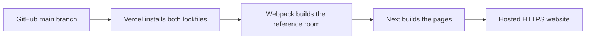

# How this website works

## The path from code to a public link

GitHub stores the source and history; it does not run the website. Vercel checks out a particular commit, installs its dependencies, builds it, and serves the generated files. A deployment dashboard URL is a control panel. The actual website has a separate HTTPS hostname, often ending in vercel.app.

A push triggers deployment only when that repository/branch is connected and automatic deployments are enabled. A successful local build or a queued browser-open request is not proof the hosted site works. Confirm the Vercel deployment is Ready and test its actual website URL.

## What is on screen

- Next.js supplies the routes: `/`, `/desktop`, `/projects`, project details, `/about`, `/resume`.
- The home page embeds the built reference renderer at `/experience/index.html`.
- Three.js draws meshes (geometry), materials (surface appearance), and a camera. The seamless reference room comes from authored geometry and baked textures, not merely a blur effect.
- The original monitor contains a same-origin HTML iframe at `/desktop`, positioned in 3D with CSS3DRenderer. Text/buttons remain real HTML.
- Pointer events from the desktop are forwarded to the room so its camera can approach the monitor. This is why the desktop and room are separate pieces that still respond together.
- The original renderer is isolated under `experience/` so changing the modern content app does not silently change its older Three.js rendering APIs.

## Scroll-driven explosion

The robotics sample has a tall section with a sticky viewer. Scroll distance is converted to a value between zero and one. Each assembly keeps its original position and adds a separation offset multiplied by that value. The same calculation runs backward as you scroll up. The slider changes the same scroll position; it is not a separate animation.

Real CAD needs a hierarchy with named components, materials, dimensions and sensible directions for each part. One flat STL cannot explain which faces belong to a motor or a frame. GLB/glTF can retain materials and hierarchy; do not apply the reference room's material-replacing BakedModel helper to colored CAD.

## The next useful work

1. Establish one working Vercel project and one public URL.
2. Accept the reference scene before replacing its assets.
3. The garage-door entrance is implemented: a CSS overlay lifts above the real scene after asset readiness; the original camera event handles the glide.
4. Replace the desk/computer with the workbench and PC.
5. Add one real project model, its story and exploded assembly.
6. Finish profile/resume facts and test phone, keyboard, model failures and loading.

This is a development baseline. Original baked branding/paper artwork still needs replacement before presenting it as a finished personal portfolio.
