# Reference baseline validation

Verified in the current cloud instance. These results do not prove a hosting deployment or GitHub Actions run.

Passed:

- Production build of the isolated original renderer and Next application.
- Root TypeScript check and formatting check.
- Real Chromium: required assets finish loading, Start reveals the room, and clicking approaches the desk.
- Original CSS3D monitor loads the same-origin personal desktop.
- Hovering an embedded desktop button approaches the monitor; About opens; Projects navigates inside the monitor.
- Project list links to the cube-solver detail page.
- Direct desktop at 390×844: no horizontal overflow, About usable.
- Resume PDF generated and extracted text includes Shreethan Palla and profile draft content.
- Initial browser run: zero page errors, zero 400+ resource responses, zero external HTTP requests.
- Branch push confirmed by reading the matching remote commit.

Known limits:

- Original inherited assets/boot are intentionally still present. The screenshot is a licensed reference baseline, not a finished customized workbench.
- Original monitor textures/paper artwork contain upstream branding and content; replace before presenting the scene as a finished personal portfolio.
- Original renderer emits JS/media size warnings. No frame-rate, real-phone performance or broad-browser claim has been established.
- Original 3D accessibility and loading-failure behavior need further work. Direct content routes are available; the direct desktop mobile check is not a full 3D mobile test.
- No real robot CAD imported. No accurate exploded assembly verified.
- No public preview deployment. Browser-panel requests earlier returned queued; localhost is not a user-accessible cloud preview.

## Scroll assembly / deployment preparation

- `/projects/robotics`: normalized scroll positions 0%, 50%, 100% map to component separation.
- Reverse scroll returns to assembled state.
- Keyboard End on the range control moves to fully separated state and corresponding scroll position.
- 390px viewport has no horizontal overflow; reduced-motion mode preserves direct scroll control.
- Chromium run reported zero page errors.
- These checks use explicitly illustrative geometry, not an accurate user robot.
- Next.js upgraded to 15.5.28 and its PostCSS dependency overridden to 8.5.30; npm audit no longer reports Next/PostCSS advisories in the root production dependency tree. This does not claim a complete audit of the inherited renderer/tooling.

## Garage intro validation

Production build passed. Chromium checks passed: Start disabled while an intentionally delayed asset loads; keyboard Start; door moves upward and is removed after reveal; original room remains visible; Skip; reduced-motion immediate camera event; aborted model load gives a working Open without 3D route; 390px entrance has no horizontal overflow. No page errors in that run. Final styled door/reveal captures are in the images folder. The final cosmetic pass also passed a fresh build and door/reveal check.

## Empty desk and classic garage door

Production build and final renderer build passed. Chromium checked the wider 390×232 entrance card, four individually tilting door sections with sixteen recessed panels, completed reveal, absence of the old monitor overlay, mobile layout/direct desktop link, and reduced-motion entry. No page errors or failed resource responses occurred in the final run. The exported scene contains exactly the original backdrop, one tabletop and four legs. Visual review confirmed the bare charcoal desk and soft floor shadows.

## Flat entrance and centered camera

Production build, final renderer build, formatting and whitespace checks passed. Final Chromium run verified flat door surfaces without background images or box shadows, independent sectional motion, completed reveal, name and ticking clock without a role subtitle, narrow entrance/desk views, and reduced-motion entry. It reported no page errors or failed asset responses. Camera projection checks against the actual keyframe classes passed at 1440×1000, 390×844 and 1920×1080; all desk bounds remain visible with horizontal centers within 1% of viewport width. Visual review of desktop and phone screenshots confirmed centered framing.

## Interactive résumé paper

The full production build and formatting/whitespace checks passed. Final Chromium checks passed: Enter reveals the room; clicking reaches the desk; the actual projected paper surface picks correctly; hovering raises/brightens it; clicking opens the readable sheet; the PDF download contains a valid one-page placeholder; Back and Escape preserve the desk view; keyboard opening, focus trapping, return focus and reopening work. Narrow 390×844 layout has no reader overflow. Touch-enabled Chromium opened and closed the sheet with taps. Reduced-motion opens without the expansion animation. The run reported no page errors or failed resource responses. PDF text extraction confirmed the user's name, placeholder label, supplied project names and GitHub URL.

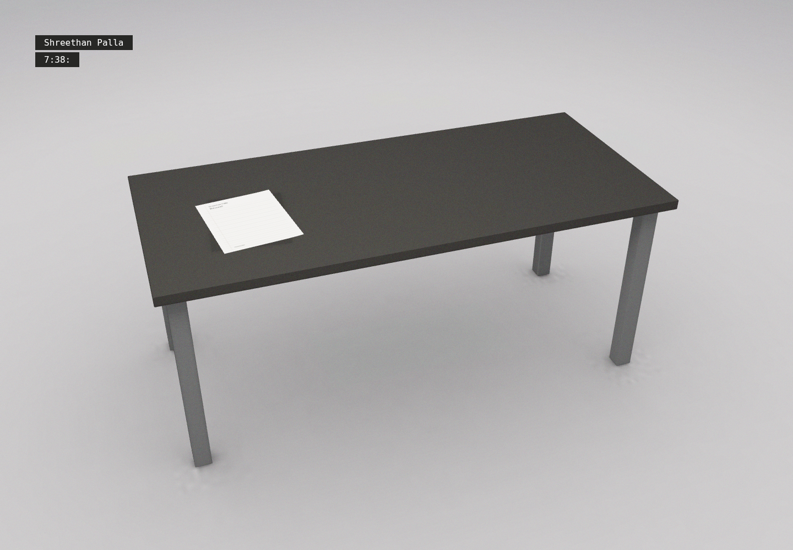

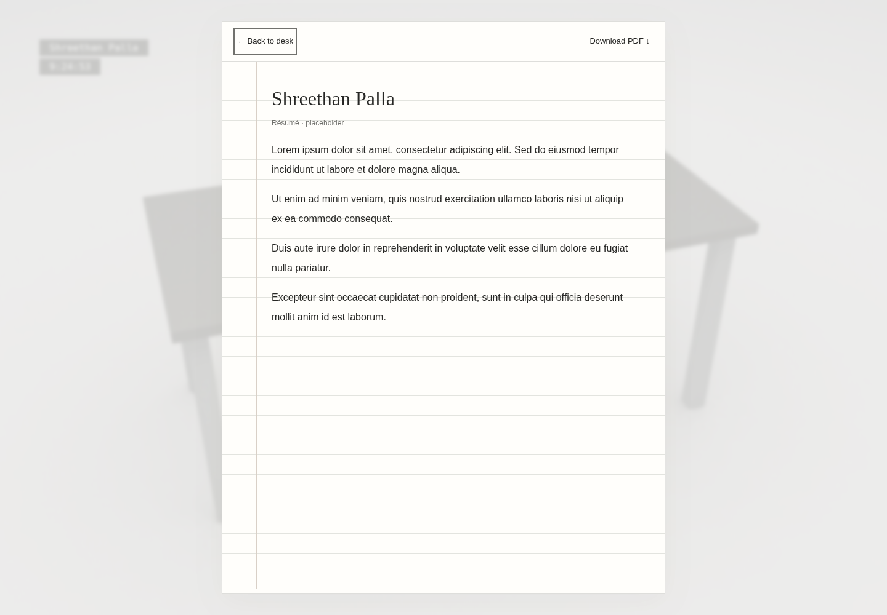

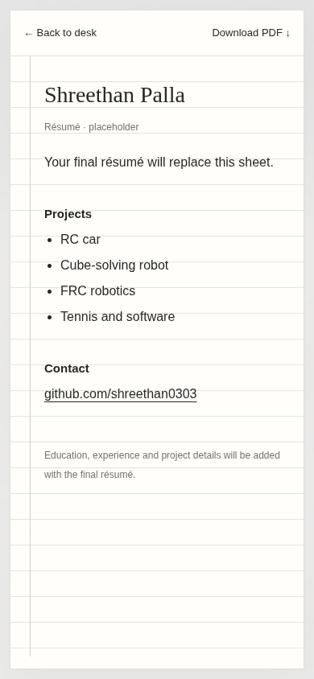

## Scroll entrance and lorem ipsum placeholder

Full production build, final renderer build and formatting checks passed. Chromium verified greeting/copy, partial wheel opening, reverse scrolling back to closed, complete entry, Enter button/keyboard entry, PageDown entry, reduced-motion entry, mobile layout and the touch-event path. A separate native CDP touch swipe also opened the door. After resizing a partly open entrance from 1440×1000 to 390×844, panel dimensions updated, reverse scrolling closed it, and scrolling reopened it. The résumé still opens/closes with touch; its HTML body and direct route contain lorem ipsum without project/contact content. The downloaded PDF is valid; text extraction confirms lorem ipsum and no project/contact text. Regular functional runs reported no page errors or failed asset requests.

The PC remains deferred. Source research verified Henry's baked-model helper, Bruno's mesh-name/material parser and resource manifest, and the glTF Transform CLI README. No exact Corsair 5000T asset has been selected or verified.

## Text-only entrance and real asset loader

Full production build, formatting and whitespace checks passed. Chromium checks held actual scene assets to verify the circular progress UI and no greeting before readiness; after release, the loader cleared without an added delay. The card and Enter button are absent. Initial scroll moved/faded the text while all door panel rotations stayed at zero; further scroll hid the copy and tilted the door sections; reversing restored the text and closed door. End-key entry, reduced-motion entry, native touch swipe and narrow text layout passed. The existing résumé still opens by keyboard and contains lorem ipsum.

An intentionally aborted audio asset produced a short failure alert, removed the spinner and left a functioning direct desktop link. Regular functional runs reported no page errors or failed resource responses; that explicit failure scenario is separate.

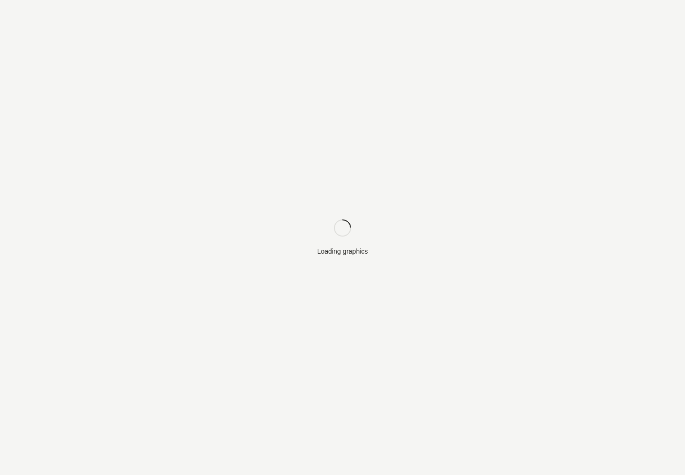

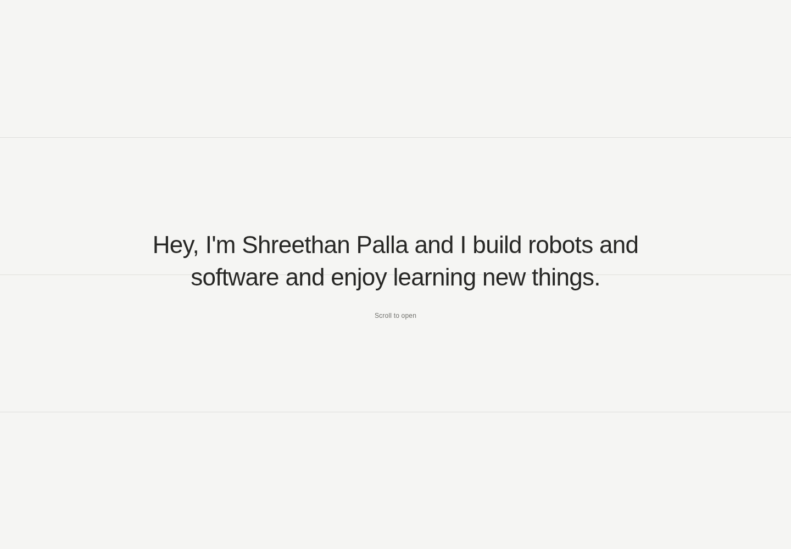

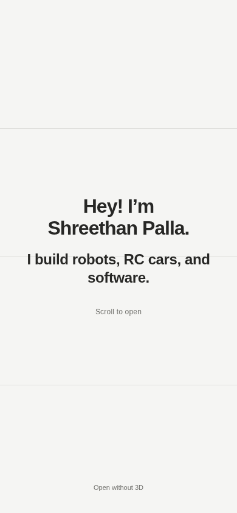

## Editable introduction and interface proposal

The full production build, formatting and whitespace checks passed. Entrance and loading copy now come from `experience/src/portfolio-copy.ts`; the intro no longer mentions RC cars. Chromium inspected the updated HTML at 1440×1000 and 390×844: the full greeting, description and hint fit within the viewport, with no horizontal overflow or page errors. Updated desktop/phone entrance screenshots are above. The existing entrance animation and scene geometry were not changed in this pass.

The content/interface guide records GitHub editing steps, branch/deployment distinctions and an Onshape-inspired monitor proposal. Public source retrieval verified Henry's separate room/inner-site structure and Brittany Chiang's v4 hero hierarchy. The proposed monitor interface has not been implemented. A local passing build is not a claim that Vercel has finished publishing this commit.

## Single-sentence entrance and prepared room reveal

Production build, formatting and whitespace checks passed. Chromium verified one uniformly styled heading with the exact plain sentence, no nested name styling and no entrance/direct-desktop links. Controlled asset release exercised all three loading messages and confirmed the SVG arc matches real progress. The intro appeared only after the workspace's first rendered frame.

Text-first scroll, reverse scroll, full door reveal, keyboard entry, reduced-motion entry and the existing lorem ipsum résumé open/close passed. The room is framed in its rotating overview before reveal, with no second distant-camera approach. Desktop 1440×1000, phone 390×844 and ultrawide 2560×1080 layouts passed; both bottom-corner 24px samples contained zero dark pixels (all channels below 90), including immediately after reveal. Visual inspection confirmed the neutral backdrop, existing soft shadows and grain. An aborted audio request showed the Reload action; removing the fault and using Reload recovered the intro. Regular requests reported zero page errors or HTTP failures.

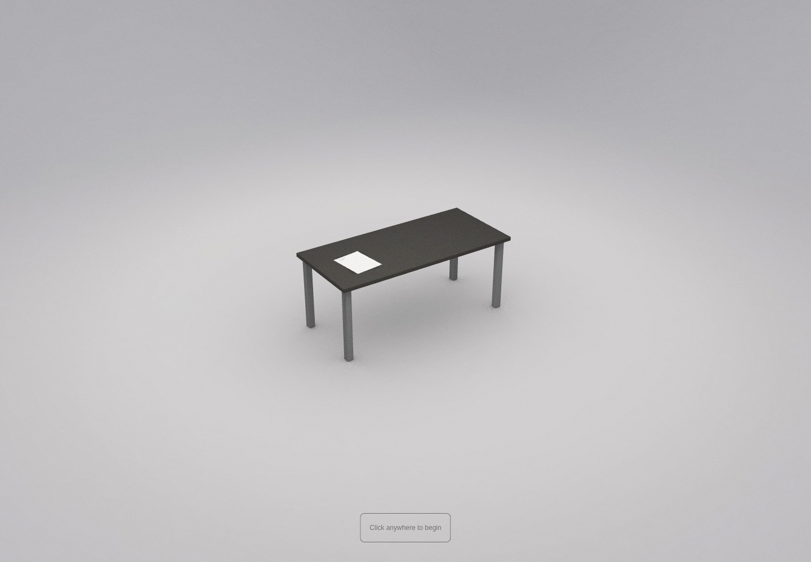

## Coordinated loading, introduction, door and desk flow

The production build and final renderer compile passed, along with formatting and whitespace checks. Final Chromium checks covered a held scene asset, a warm reload, separate intro/closed-door stages, a single large first gesture stopping at the closed door, reverse scroll, independently tilting sections, immediate full room prompt, and one camera approach despite repeated clicks. The name, clock and controls appear together on arrival; clicking empty desk space leaves the desk stable. Back to room and the existing lorem ipsum résumé open/close both passed.

On the warm reload, the visible loader-to-intro interval measured about 1.94 seconds in software-rendered Chromium, exceeding the 1.1-second minimum and including circle completion/fade. Displayed progress never leads actual readiness. The plain intro has no visible door or scroll hint; the closed door has only its small, geometrically centered hint. Native phone swipes and taps at 390×844, keyboard entry immediately after skipping the door, reduced-motion stages, and failed-asset Reload recovery passed. Regular requests reported zero page errors or HTTP failures. No synthetic typing key messages were sent during the sequence.

The animation-clock reset and independent prompt/header typing timers were removed. Camera transition events now coordinate the prompt and interface. These are local checks; they do not establish that Vercel has published this commit.

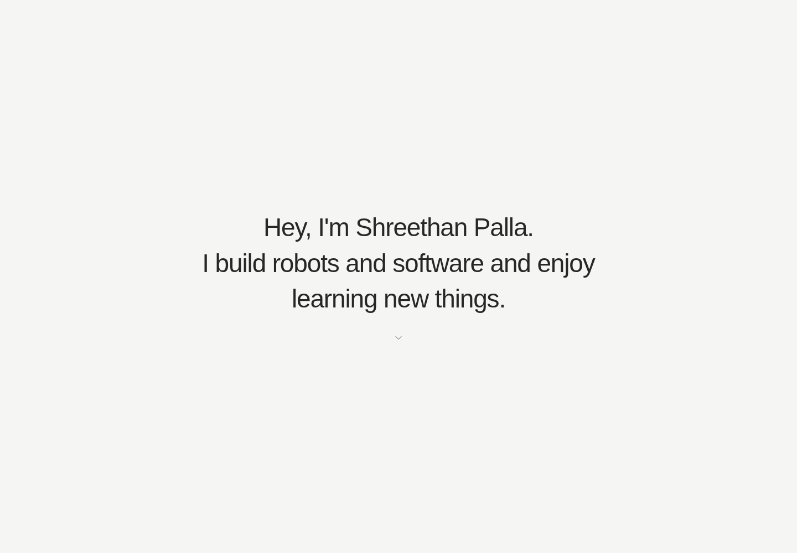

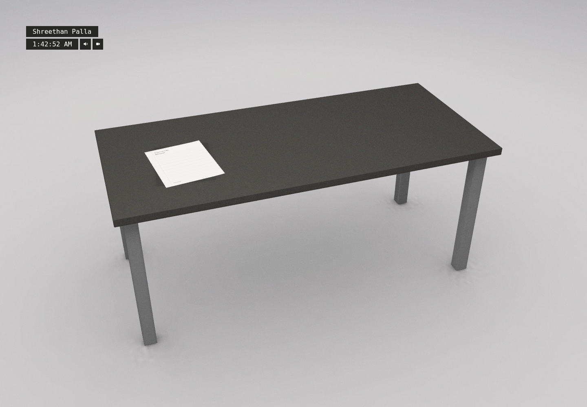

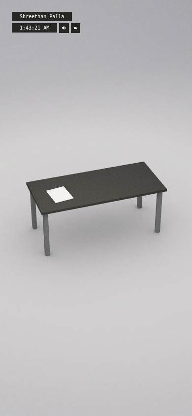

## Restore Henry's room interface and move the scroll cue

Production build, formatting and whitespace checks passed. Chromium verified the intro's subtle pulsing down chevron, zero Scroll to open text, and an empty closed-door stage. The original black-bar room prompt visibly typed from a partial “Clic” to the complete message after the door event; no typing characters were emitted before the door finished. Its black background and monospace text, and the restored black name/clock bars with white text and original controls, were checked directly and visually.

The approach starts the identity typing once, repeated clicks during travel do not reverse it, the résumé still opens/closes, and later scroll/overview returns do not replay the room prompt. Native phone swipes/taps at 390×844 passed. Reduced-motion keeps the intro chevron static and shows full room text without typing delays. Immediate keyboard approach before the prompt finishes does not leave a delayed prompt behind. Final regular runs reported zero page errors or HTTP failures.

Updated screenshots above show the restored appearance. The table, résumé geometry, lighting and grain were not modified in this correction. The continuous animation clock remains in place to avoid a camera jump after the door.

## Click/tap to play entrance stages

Production build, formatting and whitespace checks passed. Chromium verified that clicking during loading cannot bypass readiness, a click animates the introduction to the closed door, and another click opens it. Mixing these clicks with reverse/forward scrolling still works. A separate room click approaches the desk normally.

Native phone taps and reduced-motion clicks passed. The door-opening click did not also approach the desk, including when reduced-motion completed the animation synchronously. Regular requests reported zero page errors or HTTP failures. This change adds no visible controls and does not alter Henry's restored room UI.

## Equal loading-message timing and earlier room prompt

Production build, final renderer compile, formatting and whitespace checks passed. The three loading messages use independent 600ms timer slots, with complete cycles before leaving and no extra final-message dwell during the circle fade. The ring still follows real readiness. A busy frame cannot skip a statement by jumping a wall-clock index.

Software Chromium at 800×600 measured about 597–609ms per statement across three cycles with a held asset, 600–603ms on a fast reload, and 600–601ms with reduced motion. Every cycle contained all three statements in order; entry still waited for real assets and the rendered room. The restored room prompt's first typed character appeared about 45ms after the door event, with its old 500ms pause removed. Reduced-motion showed the complete prompt immediately. Final runs reported zero page errors or HTTP failures. No visual styles, text wording or other room typing rates changed.

## Actual cube-solver CAD on the desk

Converted the user-supplied STEP assembly, rather than substituting placeholder geometry. The offline preparation validates 33 cube components, a 56 mm cube and six equal outer face areas before assigning colors. The resulting GLB retains 111 mesh parts, 137,526 triangles and named assembly groups. The original STEP is outside the repository.

Production `npm run build` passed, including the isolated renderer and Next type checks. Formatting and diff whitespace checks passed. Chromium at 1000×750 verified click-through introduction/door, approach, model visibility, actual-mesh hover, click selection without camera return, keyboard highlight and résumé modal interaction lock. At 390×844, the robot remained on the tabletop, could be selected and the document width matched the viewport. Reduced-motion interaction passed. With normal motion, measured hover lift eased to 0.999 and returned to 0.001 on leaving (normalized 0–1). No page errors or 400+ resource responses were recorded. These are software-rendered cloud browser checks, not real-phone performance measurements.

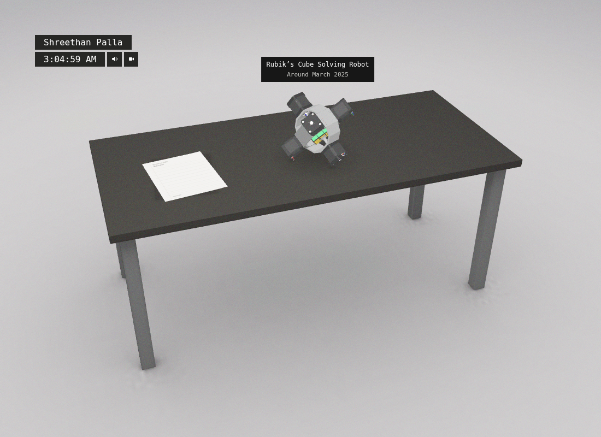

The earlier baseline and placeholder explosion sections describe historical checkpoints. This real model currently has hover/focus/select feedback only; its video/detail reader and authored exploded animation are not implemented. GitHub push and Vercel readiness are separate from local validation.

## Cube project reader and resting pose

The robot is now scaled to 85% of its original display size and tilted onto a measured support plane touching three motor assemblies. The runtime grounds the actual rotated mesh vertices. The support calculation can be repeated with `experience/tools/find-robot-support.py`; editable placement remains in `WorkshopLayout.ts`.

The production build of the renderer and Next passed, followed by a renderer rebuild for the final date and video-control styles. Chromium at 1100×800 verified the new title/date on hover, actual mesh click, rounded project reader, missing-video/link placeholders, focus trap, Escape and focus return, keyboard activation, close button and résumé regression. At 390×844, tapping opened the card; its width and scroll width both measured 358 px, with no overflow. Backdrop close passed. These checks used reduced motion; no page errors or 400+ asset responses were recorded. A separate normal-motion Chromium run verified project zoom, return to desk, closing during the zoom and restored focus, with no page errors. Real video playback is pending the supplied video. The date is provisional, based on the stated grade and current school year.

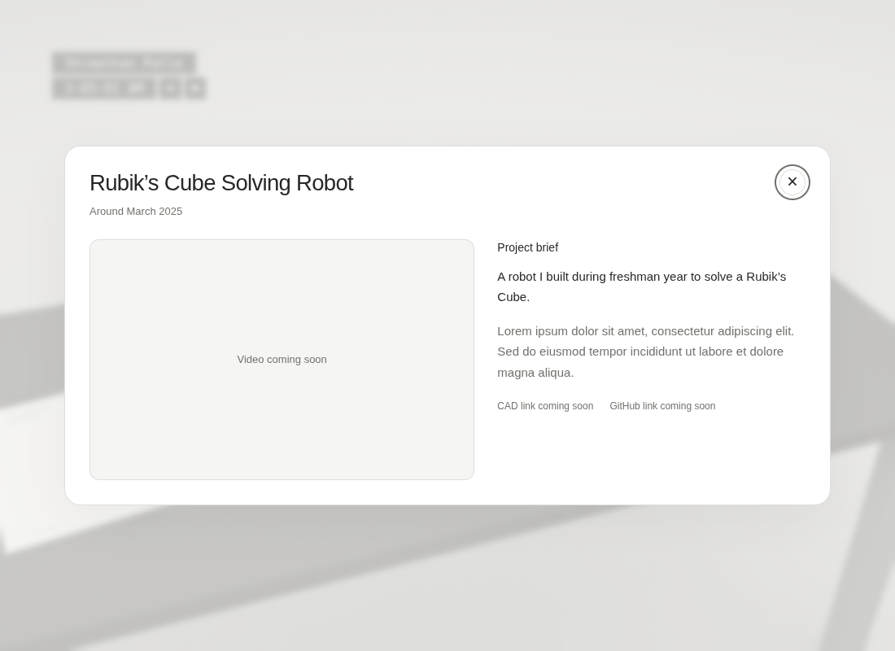

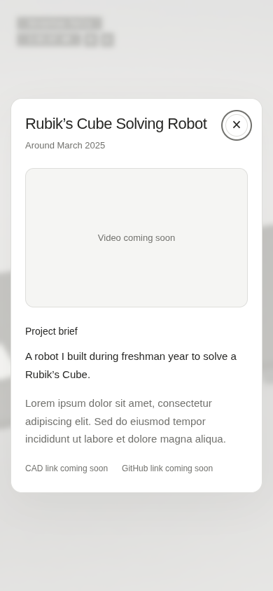

## Build-story reader

The rounded project card now contains six editable testing/prototype chapters and final reflections, with a single vertical scroll and a sticky header/close button. Project facts and chapter media remain placeholders pending the user's uploads and explanations.

The full production build passed after the final gallery changes. Chromium verified the six chapters, no empty video requests, chapter jumps below the sticky header, reflections navigation, modal focus wrapping, Escape/focus return and the same reader at 390×844 without horizontal overflow. A separate fixture used the real gallery component with a reference clip and test image: no MP4 request before play, native playback, previous/next boundaries, photo/video switching and immediate pausing on navigation passed. Fixture media and its bundle are outside the repository and are not project content. No video auto-plays, and only the selected item is mounted in each stage. This validates the gallery behavior, not the user's yet-to-arrive robot videos or their eventual encoding/size.
