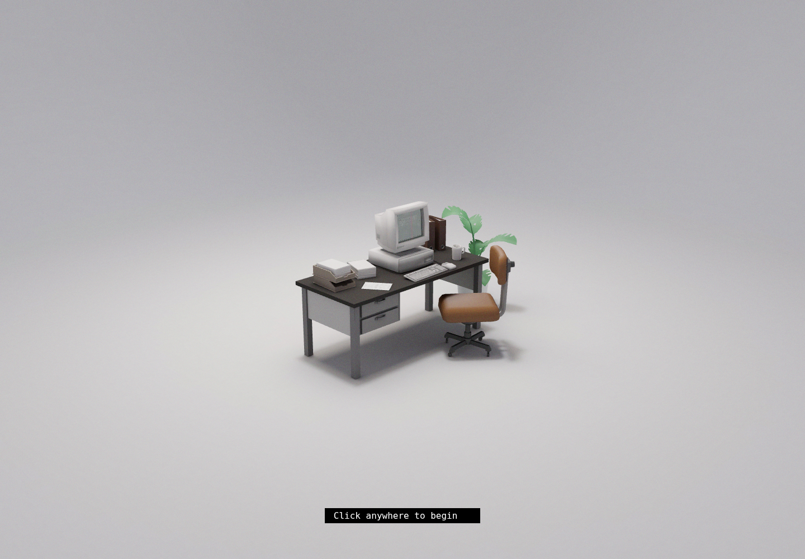
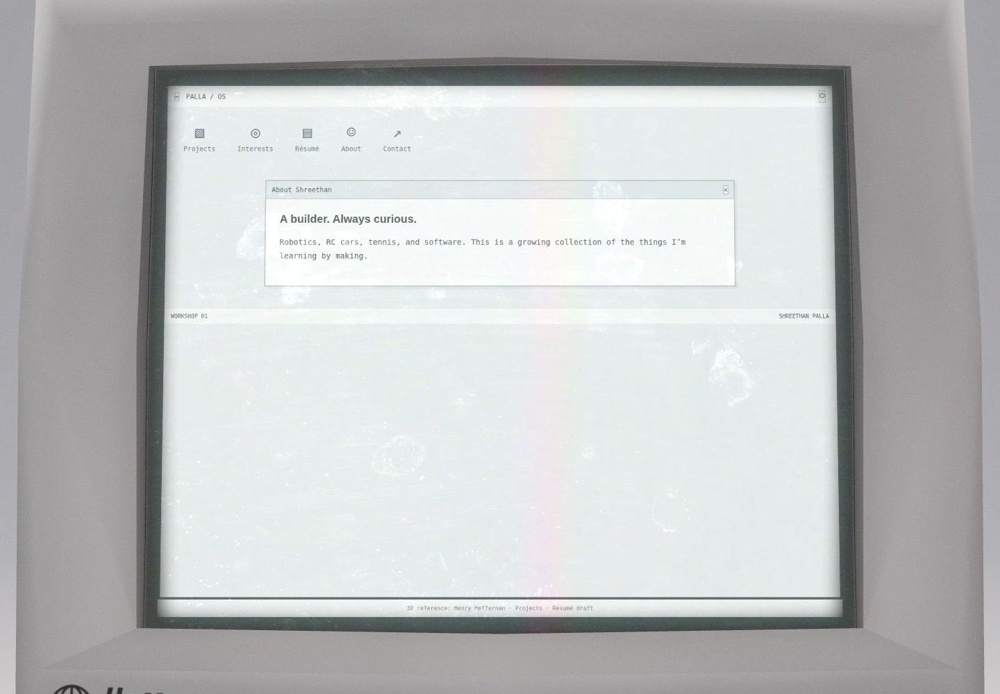
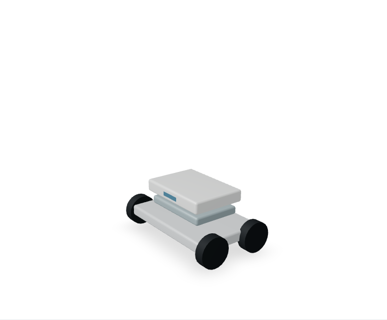
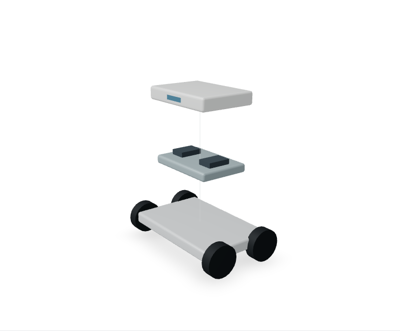
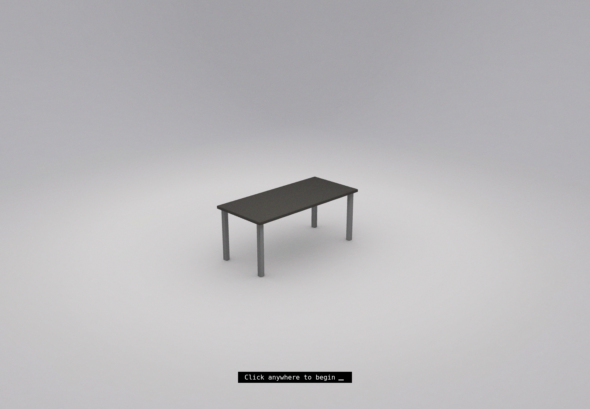
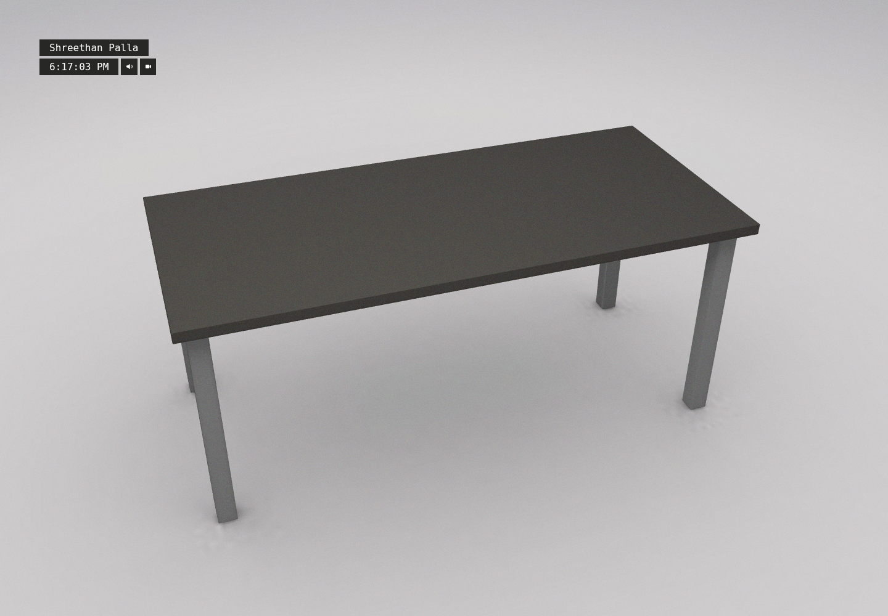

# Reference baseline validation

Verified in the current cloud instance. These results do not prove a hosting deployment or GitHub Actions run.

Passed:

- Production build of the isolated original renderer and Next application.
- Root TypeScript check and formatting check.
- Real Chromium: required assets finish loading, Start reveals the room, and clicking approaches the desk.
- Original CSS3D monitor loads the same-origin personal desktop.
- Hovering an embedded desktop button approaches the monitor; About opens; Projects navigates inside the monitor.
- Project list links to the cube-solver detail page.
- Direct desktop at 390×844: no horizontal overflow, About usable.
- Resume PDF generated and extracted text includes Shreethan Palla and profile draft content.
- Initial browser run: zero page errors, zero 400+ resource responses, zero external HTTP requests.
- Branch push confirmed by reading the matching remote commit.

Known limits:

- Original inherited assets/boot are intentionally still present. The screenshot is a licensed reference baseline, not a finished customized workbench.
- Original monitor textures/paper artwork contain upstream branding and content; replace before presenting the scene as a finished personal portfolio.
- Original renderer emits JS/media size warnings. No frame-rate, real-phone performance or broad-browser claim has been established.
- Original 3D accessibility and loading-failure behavior need further work. Direct content routes are available; the direct desktop mobile check is not a full 3D mobile test.
- No real robot CAD imported. No accurate exploded assembly verified.
- No public preview deployment. Browser-panel requests earlier returned queued; localhost is not a user-accessible cloud preview.

## Scroll assembly / deployment preparation

- `/projects/robotics`: normalized scroll positions 0%, 50%, 100% map to component separation.
- Reverse scroll returns to assembled state.
- Keyboard End on the range control moves to fully separated state and corresponding scroll position.
- 390px viewport has no horizontal overflow; reduced-motion mode preserves direct scroll control.
- Chromium run reported zero page errors.
- These checks use explicitly illustrative geometry, not an accurate user robot.
- Next.js upgraded to 15.5.28 and its PostCSS dependency overridden to 8.5.30; npm audit no longer reports Next/PostCSS advisories in the root production dependency tree. This does not claim a complete audit of the inherited renderer/tooling.

## Garage intro validation

Production build passed. Chromium checks passed: Start disabled while an intentionally delayed asset loads; keyboard Start; door moves upward and is removed after reveal; original room remains visible; Skip; reduced-motion immediate camera event; aborted model load gives a working Open without 3D route; 390px entrance has no horizontal overflow. No page errors in that run. Final styled door/reveal captures are in the images folder. The final cosmetic pass also passed a fresh build and door/reveal check.

## Empty desk and classic garage door

Production build and final renderer build passed. Chromium checked the wider 390×232 entrance card, four individually tilting door sections with sixteen recessed panels, completed reveal, absence of the old monitor overlay, mobile layout/direct desktop link, and reduced-motion entry. No page errors or failed resource responses occurred in the final run. The exported scene contains exactly the original backdrop, one tabletop and four legs. Visual review confirmed the bare charcoal desk and soft floor shadows.

## Flat entrance and centered camera

Production build, final renderer build, formatting and whitespace checks passed. Final Chromium run verified flat door surfaces without background images or box shadows, independent sectional motion, completed reveal, name and ticking clock without a role subtitle, narrow entrance/desk views, and reduced-motion entry. It reported no page errors or failed asset responses. Camera projection checks against the actual keyframe classes passed at 1440×1000, 390×844 and 1920×1080; all desk bounds remain visible with horizontal centers within 1% of viewport width. Visual review of desktop and phone screenshots confirmed centered framing.

